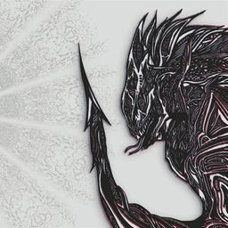

# Psychedelic Reptilian (Animated) — Ultrawide 5120×2160

An audio-reactive [Wallpaper Engine](https://www.wallpaperengine.io/) scene for ultrawide screens.
It works at any resolution: the creature is laid out by script, so it stays 90 % of the screen
height, pinned to the bottom-right corner (WE's flip option mirrors it to the left).



## What moves
- **The creature**: hair, tendrils, tail, head, body, belly and face are driven by painted motion
  rigs (flow + time maps). The eyes spin and wander, the gills sway, the eyelids blink, and a
  lens + chromatic aberration pass sits on top.
- **The arm follows the mouse**: the whole spike next to the head, from the coil it grows out of
  to the tip, leans toward the cursor (up to 150 px at the tip on the 5040-wide art) on a slightly
  springy curve. When the cursor is below the tip it also lowers (up to 120 px), so with the
  cursor on the mandala's centre the tail points at it like a record needle.
- **Smoke**: light black smoke (Wallpaper Engine's own smoke sprites) rises from both screen edges,
  behind the creature on its side and mirrored on the other, drifts slightly inward and fades out
  around two-thirds of the height.
- **Music**: the magenta and cyan ink layers pulse with the audio. Five blue bands across the chest
  and tail light up one frequency band each, and an extra cyan layer reacts to the bass.
- **Spectrum mandala** (the 13-fold Choronzon mandala behind the creature) turns slowly and
  breathes when there is no sound. With music it splits into 13 pieces, one per frequency band,
  and adds a bass swell, datamosh frames and beat glitches. Optionally its spin follows the song's
  tempo: the script detects the BPM live (onset autocorrelation, 70–160 BPM) and turns the wheel
  one piece every N beats.

## User properties
| Property | Default |
|---|---|
| Magenta / Cyan (ink colours) | `#FF124F` / `#30F6FF` |
| Tail follows mouse (%) | 100 |
| Mandala spin (seconds per turn) | 39 |
| Mandala min / max opacity (%) | 0 / 15 |
| Mandala blur (px) | 0 |
| Mandala beat glitch (on/off) + Glitch strength (%, 0–300) | on, 100 |
| Mandala datamosh noise (on/off) + Datamosh strength (%, 0–300) | on, 100 |
| Mandala spin follows BPM (on/off) + Beats per piece (1–16, 13 pieces per turn) | off, 4 |
| Smoke behind the creature (on/off, both edges) + Smoke opacity (%, 0–200) | on, 100 |

## Install
Copy `wallpaper/` into `steamapps/common/wallpaper_engine/projects/myprojects/<any name>/` and
pick it in Wallpaper Engine (or open its `project.json` from the editor).

## Performance
Each creature layer renders in one generated shader pass ("Creature warp") that reproduces the
whole chain of built-in effects it replaced. The chain is walked backwards as a composition of
coordinate maps, followed by a single texture read. The layers are also cropped to the area the
creature can reach. Textures are GPU-compressed (DXT5) where that is visually lossless: every
creature layer is one flat colour plus alpha, so only the alpha is approximated, and only on
anti-aliased edge pixels.

| | Before | After |
|---|---|---|
| Effect passes (creature) | 142 | 21 |
| GPU 3D load, wallpaper visible (2560×1080, RTX 3080 Ti) | ~34 % | ~4 % silent, ~10–25 % with music |
| VRAM (Wallpaper Engine process) | 1196 MB | ~570 MB |
| Project size | 73 MB | 23 MB |

Details: [`docs/HANDOFF_animation.md`](docs/HANDOFF_animation.md) §13 and the header of
[`scripts/shader/creature_warp.frag.in`](scripts/shader/creature_warp.frag.in).

## Repository layout
The repo is a complete copy of the project: everything the current pipeline reads is here.

| Path | Contents |
|---|---|
| `wallpaper/` | The Wallpaper Engine project: scene, textures, masks, effects, generated shaders |
| `scripts/` | The pipeline (`optimize_creature.py` and the earlier `add_*.py` / `apply_rig4.py`), the scene scripts (`*.js`), the shader sources (`scripts/shader/`), `we_paths.py` (finds the WE project) |
| `tools/` | Rig generators (`arm_follow_field.py`, …), `.tex` reader/writer (`tex_io.py`), preview and verification helpers |
| `backups/2026-11-07_before_optimize/project/` | **The optimiser's source**: the scene before the performance pass, with full textures and every motion mask. Effect changes go here, then `optimize_creature.py` rebuilds `wallpaper/` |
| `recovered_original/` | The art layers and the original masks as lossless PNG |
| `rig/` | The motion maps as editable PNGs, plus reports and previews |
| `mock/` | Still mocks shown before building (the edge smoke) and the script that drew them |
| `Choronzon_mandala_black.png`, `mandala_canvas.png` | Mandala sources |
| `docs/` | Working notes: how the rig, the mandala, the optimization and the arm follow were built and verified |

## Set up on a new machine
1. Install Wallpaper Engine (Steam), Git and Python 3.13, then:
   ```
   git clone https://github.com/jgoa156/reptilian-ultrawide-wallpaper-engine.git
   pip install numpy scipy pillow opencv-python lz4
   ```
   (`lz4` makes the scripts write byte-identical textures; without it they still work, with
   slightly larger files.)
2. Let Wallpaper Engine load the repo's `wallpaper/` folder directly, with a junction (run in
   `cmd`, adjusting the Steam path):
   ```
   mklink /J "C:\Program Files (x86)\Steam\steamapps\common\wallpaper_engine\projects\myprojects\reptilian_ultrawide_5120" "<clone>\wallpaper"
   ```
   Then pick it in Wallpaper Engine. `python scripts/we_paths.py` prints the project folder the
   scripts will write to: the junction, found in any Steam library. Without the junction they
   write to `wallpaper/` itself. `REPTILIAN_WE_PROJECT` overrides both.
3. Rebuild after a change (e.g. arm reach): `python tools/arm_follow_field.py --tip 180`, then
   `python scripts/optimize_creature.py`. Re-select the wallpaper in WE to reload it, then commit.

`optimize_creature.py` rebuilds `wallpaper/scene.json` from the source project, so a scene
change made in the WE editor on `wallpaper/` (layers, effects, particles) lasts only until the
next run. For lasting changes, edit the source project (it opens in the WE editor too), then run
the optimiser. `project.json` (user properties, title, preview) is not rebuilt; the glitch
and BPM-spin properties come from `scripts/add_mandala_properties.py`, the smoke layer and its two
properties from `scripts/add_edge_smoke.py`. The mandala's controller script is
`scripts/mandala_controller.js`, injected by the optimiser. `scene.pkg` is the package Wallpaper
Engine writes when you publish; it is not kept in the repo.

## Credits
- **Artwork**: the Reptilian illustration by [death.yon](https://www.instagram.com/death.yon).
- **Chromatic Aberration (+Audio Response)** by fug4life, Steam Workshop
  [2423877731](https://steamcommunity.com/sharedfiles/filedetails/?id=2423877731). The effect
  files in `wallpaper/effects/workshop/2423877731` and `wallpaper/shaders/workshop/2423877731`
  are the author's, bundled unmodified for the background layer.
- **Lens distortion** by Gariam, Steam Workshop
  [2811235087](https://steamcommunity.com/sharedfiles/filedetails/?id=2811235087). The lens and
  chromatic-aberration math in the Creature warp shader reimplements that effect.
- Built-in Wallpaper Engine effects (spin, twirl, iris, foliage sway, water waves, shake, pulse,
  radial blur, edge detection) are reproduced from WE's own shader math.
